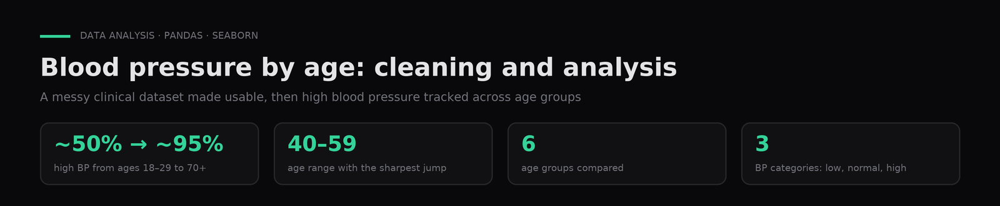
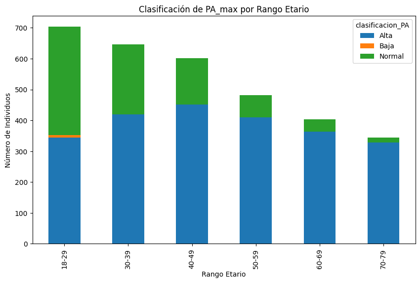

# Blood pressure by age, cleaning and analysis

**Cleaning a clinical dataset full of entry errors, and analyzing peak blood pressure by age group.**

`Python` · `pandas` · `NumPy` · `Seaborn` · [Leer en español ↓](#español)

---

## Problem

The data mixed units, decimal commas and impossible values.

## Data

A course-provided clinical dataset (`talla-peso-edad.csv`) with height, weight, sex, age and peak blood pressure. Not included in the repo.

## Approach

Unit normalization, filtering of impossible values, low/normal/high blood-pressure classification, and a cross-tab by age group.

## Results

High blood pressure goes from about half of cases at ages 18–29 to nearly all cases after 70, with the sharpest jump between 40 and 59.

The cleaning had to handle heights in centimeters mixed with meters, decimal commas, and physically impossible values before any analysis made sense.

## How to run

1. `pip install -r requirements.txt`.
2. Save the dataset as `data/talla-peso-edad.csv` and run `notebooks/blood_pressure_eda.ipynb`.

## Context

Coursework for **Professional Practicum I** in the AI & Data Science program (Colegio Universitario IES · Universidad Siglo 21, 2024). Author: **Gaspar Quintana**.

---

## Español

**Limpieza de un dataset clínico con errores de carga y análisis de la presión arterial máxima por rango etario.**

**Problema.** Los datos mezclaban unidades, comas decimales y valores imposibles.

**Datos.** Dataset clínico de la cátedra (`talla-peso-edad.csv`) con altura, peso, sexo, edad y presión arterial máxima. No se incluye en el repo.

**Método.** Normalización de unidades, filtrado de valores imposibles, clasificación de la presión en baja, normal y alta, y cruce con rangos etarios.

**Resultados.** La presión alta pasa de cerca de la mitad de los casos entre los 18 y 29 años a casi la totalidad después de los 70, con el salto más marcado entre los 40 y los 59.

**Contexto.** Trabajo de **Práctica Profesionalizante I**, Tecnicatura en IA y Ciencia de Datos (Colegio Universitario IES · Universidad Siglo 21, 2024). Autor: **Gaspar Quintana**.
